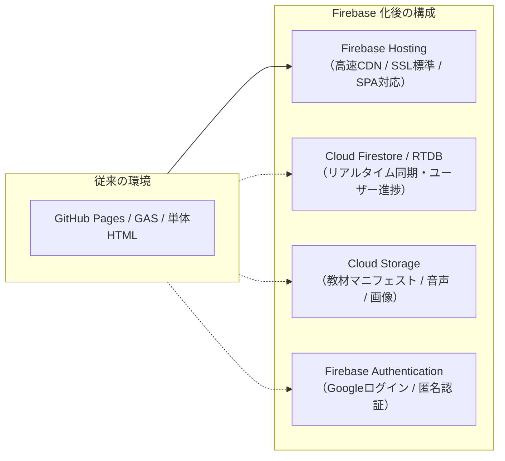

# 既存WebアプリのFirebase移行＆デプロイ完全ガイド

本ドキュメントは、**GitHub Pages や Google Apps Script (GAS)、ローカル環境などの他プラットフォームで動いていた既存Webアプリを Firebase へ移行し、安全かつ迅速に運用・デプロイするための仕様書およびショートカット集** です。

別プロジェクト（漢字学習アプリ、英語学習アプリ等）にそのままコピー＆ペーストして使える設定ファイルテンプレートと PowerShell スクリプトを収録しています。

---

## 1. 移行の全体像（他プラットフォーム → Firebase）



### 役割の対比表

| 機能 | 従来のプラットフォーム（Pages/GAS等） | Firebase 化後 | メリット |
| :--- | :--- | :--- | :--- |
| **画面配信 (Hosting)** | GitHub Pages (`docs/` 等) / GAS HTML | **Firebase Hosting** | 高速CDN、独自ドメイン、プレビュー環境（PR単位検証）、詳細なキャッシュ制御が可能 |
| **データ永続化 (DB)** | スプレッドシート / localStorage | **Cloud Firestore / RTDB** | リアルタイム同期、オフライン同期、堅牢なセキュリティルール |
| **大容量・教材配信** | Google Drive / GitHub raw | **Cloud Storage / Hosting静的配置** | CORS問題なし、HTTP/2高速配信、帯域制御 |
| **ユーザー認証** | GASセッション / OAuth自作 | **Firebase Auth** | Googleログイン・匿名ログインが数行で完結、トークン検証が堅牢 |

---

## 2. Firebase 基本設定ファイルの仕様とテンプレート

新プロジェクトのルートディレクトリに配置する必須ファイル群です。

### ① `.firebaserc` （プロジェクト接続定義）

複数のFirebaseプロジェクト（本番環境・実験用環境）をエイリアスで切り替えられるようにします。

```json
{
  "projects": {
    "default": "jikkenfirebasekankyo",
    "production": "your-prod-app-id"
  }
}
```
- `default`: 通常デプロイされる環境（実験用など）。
- `firebase use default` や `firebase use production` で一瞬で切り替えられます。

---

### ② `firebase.json` （全体仕様定義）

#### パターン A: Vanilla HTML/JS構成（ビルド不要、`index.html` がルートにある場合）
`ESEnglishKanji` のように単一のHTMLとJavaScript群で構成されている場合の設定です。

```json
{
  "hosting": {
    "public": ".",
    "ignore": [
      "firebase.json",
      ".firebaserc",
      "**/.*",
      "**/node_modules/**",
      "**/*.ps1",
      "**/*.md"
    ],
    "rewrites": [
      {
        "source": "**",
        "destination": "/index.html"
      }
    ],
    "headers": [
      {
        "source": "**/*.@(js|css)",
        "headers": [
          {
            "key": "Cache-Control",
            "value": "max-age=86400"
          }
        ]
      },
      {
        "source": "index.html",
        "headers": [
          {
            "key": "Cache-Control",
            "value": "no-cache, no-store, must-revalidate"
          }
        ]
      },
      {
        "source": "**/manifest-index.json",
        "headers": [
          {
            "key": "Cache-Control",
            "value": "no-cache, no-store, must-revalidate"
          }
        ]
      }
    ]
  },
  "firestore": {
    "rules": "firestore.rules",
    "indexes": "firestore.indexes.json"
  },
  "storage": {
    "rules": "storage.rules"
  }
}
```

#### パターン B: Vite / React / TypeScript構成（`client/dist` を配信する場合）
本プロジェクト（`firebase-digital-drill`）のようにビルド成果物がある場合の設定です。

```json
{
  "hosting": {
    "public": "client/dist",
    "ignore": [
      "firebase.json",
      "**/.*",
      "**/node_modules/**"
    ],
    "rewrites": [
      {
        "source": "**",
        "destination": "/index.html"
      }
    ]
  },
  "firestore": {
    "rules": "firestore.rules",
    "indexes": "firestore.indexes.json"
  },
  "storage": {
    "rules": "storage.rules"
  }
}
```

---

### ③ `firestore.rules` （セキュリティルール仕様）

全拒否ではなく、**「認証済みユーザーは自分の進捗だけ読み書きできる」「教材マニフェストは全ユーザーが読める」** 最小のセキュアルールです。

```javascript
rules_version = '2';
service cloud.firestore {
  match /databases/{database}/documents {

    // 認証ヘルパー関数
    function isAuthenticated() {
      return request.auth != null;
    }
    function isOwner(userId) {
      return isAuthenticated() && request.auth.uid == userId;
    }

    // 教材マスター・共通システム設定（全ユーザー読み取り可、書き込み不可）
    match /system/{document=**} {
      allow read: if true;
      allow write: if false; // 管理者・GAS・スクリプトのみ（Admin SDK経由）
    }

    // ユーザー個別の進捗・回答履歴（本人だけがアクセス可）
    match /users/{userId}/{document=**} {
      allow read, write: if isOwner(userId);
    }

    // その他のコレクションは原則拒否
    match /{document=**} {
      allow read, write: if false;
    }
  }
}
```

---

### ④ `storage.rules` （Cloud Storage ルール仕様）

```javascript
rules_version = '2';
service firebase.storage {
  match /b/{bucket}/o {
    // 公開教材・マニフェストJSON・音声アセット（誰でも読み取り可、クライアント書き込み不可）
    match /materials/{allPaths=**} {
      allow read: if true;
      allow write: if false;
    }

    // デフォルト拒否
    match /{allPaths=**} {
      allow read, write: if false;
    }
  }
}
```

---

## 3. デプロイのためのショートカット集

### ① PowerShell ワンコマンド・デプロイスクリプト (`scripts/deploy-fb.ps1`)

プロジェクトルート直下の `scripts/deploy-fb.ps1` に配置することで、ビルドとデプロイを1文字もミスすることなく実行できます。

```powershell
#Requires -Version 5.1
<#
.SYNOPSIS
  Firebase Deploy Helper Script
.PARAMETER HostingOnly
  Hosting (画面) のみデプロイ
.PARAMETER RulesOnly
  Firestore / Storage ルールのみデプロイ
.PARAMETER SkipBuild
  ビルド処理 (npm run build 等) をスキップ
.PARAMETER Target
  デプロイ先プロジェクト (例: -Target production)
#>
param(
  [switch]$HostingOnly,
  [switch]$RulesOnly,
  [switch]$SkipBuild,
  [string]$Target
)

$ErrorActionPreference = 'Stop'
Set-StrictMode -Version Latest

$Root = Split-Path -Parent $PSScriptRoot
Set-Location $Root

function Write-Step([string]$Message) {
  Write-Host ''
  Write-Host "==> $Message" -ForegroundColor Cyan
}

function Fail-Exit([string]$Label) {
  $code = $LASTEXITCODE
  throw "$Label failed (exit=$code)"
}

# 1. コマンド存在チェック
if (-not (Get-Command 'firebase' -ErrorAction SilentlyContinue)) {
  throw "firebase CLI が見つかりません。npm i -g firebase-tools を実行してください。"
}

# 2. プロジェクト切替（指定がある場合）
if ($Target) {
  Write-Step "Firebase project use: $Target"
  firebase use $Target
  if ($LASTEXITCODE -ne 0) { Fail-Exit 'firebase use' }
}

# 3. ビルド処理（package.json に build がある場合かつ SkipBuild ではない場合）
if (-not $SkipBuild) {
  $ClientDir = Join-Path $Root 'client'
  if (Test-Path (Join-Path $ClientDir 'package.json')) {
    Write-Step 'Building client (Vite/TS)...'
    Push-Location $ClientDir
    npm run build
    if ($LASTEXITCODE -ne 0) { Fail-Exit 'Client build' }
    Pop-Location
  } elseif (Test-Path (Join-Path $Root 'package.json')) {
    $pkg = Get-Content (Join-Path $Root 'package.json') -Raw | ConvertFrom-Json
    if ($pkg.scripts.build) {
      Write-Step 'Building root project...'
      npm run build
      if ($LASTEXITCODE -ne 0) { Fail-Exit 'Root build' }
    }
  }
}

# 4. デプロイ実行
if ($RulesOnly) {
  Write-Step 'Deploying Rules only (Firestore & Storage)...'
  firebase deploy --only firestore:rules,storage
} elseif ($HostingOnly) {
  Write-Step 'Deploying Hosting only...'
  firebase deploy --only hosting
} else {
  Write-Step 'Deploying Full Stack (Hosting + Rules)...'
  firebase deploy --only hosting,firestore:rules,storage
}

if ($LASTEXITCODE -ne 0) { Fail-Exit 'firebase deploy' }

Write-Host ''
Write-Host '==> Deploy successfully finished!' -ForegroundColor Green
```

#### スクリプトの実行方法（VS Code / PowerShell ターミナル）
```powershell
# 全体をビルドしてデプロイ
.\scripts\deploy-fb.ps1

# 画面 (Hosting) だけを素早く更新
.\scripts\deploy-fb.ps1 -HostingOnly

# ビルドをスキップして Hosting を即時反映
.\scripts\deploy-fb.ps1 -HostingOnly -SkipBuild

# ルール変更だけを反映
.\scripts\deploy-fb.ps1 -RulesOnly

# 本番環境へ切り替えてデプロイ
.\scripts\deploy-fb.ps1 -Target production
```

---

### ② `package.json` ショートカット（npm scripts）

プロジェクトルートの `package.json` に以下を登録しておくと、`npm run deploy` などの短縮コマンドが使えます。

```json
{
  "name": "my-app",
  "scripts": {
    "deploy": "powershell -ExecutionPolicy Bypass -File ./scripts/deploy-fb.ps1",
    "deploy:hosting": "powershell -ExecutionPolicy Bypass -File ./scripts/deploy-fb.ps1 -HostingOnly",
    "deploy:rules": "powershell -ExecutionPolicy Bypass -File ./scripts/deploy-fb.ps1 -RulesOnly",
    "deploy:quick": "powershell -ExecutionPolicy Bypass -File ./scripts/deploy-fb.ps1 -HostingOnly -SkipBuild",
    "preview": "firebase hosting:channel:deploy test-preview"
  }
}
```

---

### ③ Firebase CLI 必須コマンド早見表（チートシート）

| やりたいこと | 実行コマンド | 備考 |
| :--- | :--- | :--- |
| **ログイン** | `firebase login` | 初回のみ（Googleアカウントでブラウザ認証） |
| **現在プロジェクト確認** | `firebase projects:list` / `firebase use` | 現在アクティブなプロジェクトIDを表示 |
| **プロジェクト切り替え** | `firebase use <projectId or alias>` | 例: `firebase use jikkenfirebasekankyo` |
| **全体デプロイ** | `firebase deploy` | Hosting, Rules, Storage 等を一括反映 |
| **Hosting のみ即座にデプロイ** | `firebase deploy --only hosting` | 一番よく使うコマンド（数秒で完了） |
| **Firestore ルールのみデプロイ** | `firebase deploy --only firestore:rules` | ルール変更時（クライアント再配備不要） |
| **Storage ルールのみデプロイ** | `firebase deploy --only storage` | Storageルール変更時 |
| **一時プレビュー環境を作成** | `firebase hosting:channel:deploy <channelName>` | 本番に影響を与えずに別URLで動作確認（7日間有効） |
| **ローカルエミュレータ起動** | `firebase emulators:start` | ローカルPC上でFirebase環境を完全再現 |

---

## 4. 移行時の落とし穴（ハマりどころ）とチェックリスト

### ① 認証（Firebase Auth）の承認済みドメイン追加
Googleログインなどを利用する場合、**デプロイ先のドメインを許可リストに入れておかないとログインエラー**になります。
- **設定場所**: Firebase Console → **Authentication** → **Settings（設定）** → **Authorized domains（承認済みドメイン）**
- **必須追加ドメイン**:
  1. `localhost`（ローカル開発用）
  2. `<your-project-id>.web.app`（既定）
  3. `<your-project-id>.firebaseapp.com`（既定）
  4. カスタムドメイン（独自ドメインを使用する場合）

### ② SPA（Single Page Application）の 404 エラー
ブラウザのURLを直接 `/quiz/kanji` などのサブパスにしてリロードした際、Firebase Hosting が「その名前のファイルがない」と判定して 404 を返す問題。
- **対処**: `firebase.json` の `rewrites` に以下を含めることで、全URLを `index.html` に集約できます。
  ```json
  "rewrites": [ { "source": "**", "destination": "/index.html" } ]
  ```

### ③ キャッシュ事故（古いコードが残り続ける問題）
`index.html` がブラウザに強烈にキャッシュされてしまうと、新しくデプロイしてもユーザーの画面が更新されません。
- **対処**: `firebase.json` の `headers` で `index.html` と `manifest-index.json` に `no-cache, no-store, must-revalidate` を強制指定します（前述のテンプレートに含まれています）。

### ④ 相対パス vs 絶対パス
GitHub Pages ではレポジトリ名（例: `/ESEnglishKanji/`）がパスに含まれることが多く、`./js/quiz.js` や `<base href="...">` を使っていたケースがあります。
- Firebase Hosting では**ドメイン直下（ルート `/`）が起点**になるため、絶対パス `/js/quiz.js` または相対パス `./js/quiz.js` の起点が正しいか確認してください。

---

## 5. 新アプリへの導入ステップ（最短手順）

1. **新アプリのフォルダを開く**
   ```bash
   cd c:\Users\enhan\コード開発\Projects\ESEnglishKanji
   ```
2. **設定ファイルを配置する**
   - 上記のテンプレートから `.firebaserc` と `firebase.json` を作成
   - `scripts/deploy-fb.ps1` を作成
3. **プロジェクトIDを確認・指定**
   ```bash
   firebase use jikkenfirebasekankyo
   ```
4. **一発デプロイ実行！**
   ```powershell
   .\scripts\deploy-fb.ps1 -HostingOnly
   ```
   コンソールに出力された `https://jikkenfirebasekankyo.web.app` を開いて動作を確認します。
