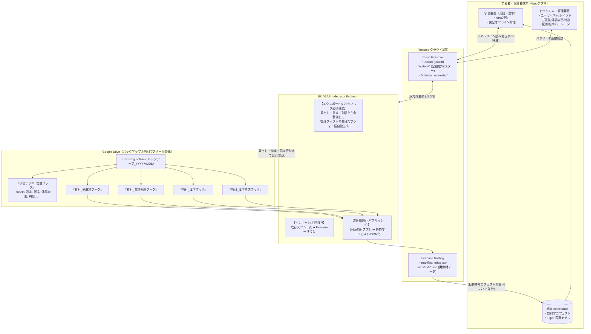

# Firebase完全自立型アーキテクチャ 移行＆運用総合設計書
## （教材マニフェスト主軸化・見出し付き完全スプシ双方向エクスポート・フル管理UI）

本ドキュメントは、**「Webアプリ（ESEnglishKanji）をGoogleスプレッドシートの日常通信から完全に切り離し、教材マニフェストとCloud Firestoreを中心に据えた超高速・完全自立型Webアプリへと昇華させる」** ための包括的な移行計画および技術仕様書です。

既存のスプレッドシート運用家庭からの移行はもちろん、**「最初からFirebase版で運用を開始した家庭」がいつでも教材データや内部設定パラメータを、見出し・カラム順・書式が100%整ったGoogleスプレッドシート群としてワンクリックでエクスポート（バックアップ）できる双方向互換性・可搬性**を完全定義します。

---

## 1. 基本方針と全体像



### 3つの鉄則
1. **日常運用の完全自立（GAS直接通信の全廃）**:
   - クイズ完了、PIN認証、ポイント加減算、景品交換、外部学習申請、パラメータ調整で **GASの同期fetch（待機）を行わない**。
   - 全て Firestore および IndexedDB で完結させ、GAS特有のコールドスタート（15〜30秒待ち）や同時実行制限を日常から完全に排除する。
2. **教材データは「静的マニフェスト（ハッシュ付きJSON）」が正本**:
   - 英語・漢字の問題データはビルド済みの静的マニフェストから読み込み、ネットワーク通信量をほぼ0バイトにする。
3. **完全なスプレッドシート互換性の維持（可搬性・非ロックイン・見出し自動整備）**:
   - 既存スプシからの移行だけでなく、**Firebase版からスタートした家庭でも、仲介GASのワンクリック操作で「見出し行・書式・列幅・データ型が美しく整備されたGoogleスプレッドシート群（管理ブック＋各教材ブック）」を一発自動生成・エクスポートできる**こと。

---

## 2. 2つの開始シナリオとライフサイクル

本アーキテクチャは、利用開始時の状況に関わらず、すべての家庭に完全なデータ主権と自由度を提供します。

### シナリオ A: 既存スプレッドシート運用家庭の「移行」
1. **エクスポート（旧スプシ側）**: 旧『学習アプリ_管理ブック』の全シート（users, アプリ設定, rewards, 外部学習, 特訓メニュー等）を仲介GASでJSON抽出。
2. **インポート（Firebase側）**: 抽出したデータを Firestore の各コレクションへ一括流し込み。
3. **切り替え完了**: 以降、日常の学習や管理はスプレッドシートを開かず、Webアプリ上で超高速に完結。

### シナリオ B: Firebase版から新規スタートする家庭（本設計の重要要件）
1. **Firebase上で即時運用開始**:
   - スプレッドシートを1枚も持たない状態からスタート。
   - Webアプリのおうちの人（管理者画面）でユーザー登録、PIN設定、ご褒美登録を行い、標準バンドルのマニフェスト教材で即座に学習開始。
2. **バックアップ・独自教材編集の要望が発生**:
   - 「子供が頑張って貯めたポイントや学習履歴、独自のご褒美設定をスプレッドシートとしてバックアップしたい」
   - 「標準で入っている英単語や漢字の教材データをスプレッドシートで手元に出力し、家族オリジナルの問題を追加・改定したい」
3. **仲介GASによるワンクリック一括生成**:
   - 管理者画面から **「Googleドライブへ完全バックアップを一括出力」** を実行。
   - 仲介GASが、見出し行・列順・配色・固定枠・データ型を完璧に整えた『学習アプリ_管理ブック』および4大『教材スプレッドシート群』をGoogleドライブ上に自動生成。
   - 生成されたスプレッドシートを編集し、仲介GASの「Firebase出版」ボタンを押せば、自分専用の教材マニフェストとして即座にアプリへ再反映可能。

---

## 3. 【必須機能】仲介GASにおける見出し付きスプレッドシート完全生成仕様

Firebase版から始めた家庭のために、仲介GAS（`spreadsheet-firebase-mediator`）が自動生成するスプレッドシート群の詳細仕様です。  
人間が目視しても美しく、旧版の読み込みロジックが1ミリもエラーを起こさない「100%完全互換の見出しとデータ書式」を保証します。

### 3.1. バックアップ出力フォルダの構成
エクスポート実行時、指定ドライブ（またはマイドライブ直下）にタイムスタンプ付きフォルダが自動生成され、その中に以下の5つのスプレッドシートが格納されます。

```
📁 ESEnglishKanji_バックアップ_20261012_2130/
 ├── 📊 1_学習アプリ_管理ブック.gsheet      （ユーザー/全設定/景品/外部学習/特訓）
 ├── 📘 2_教材_英単語ブック.gsheet          （全英単語データ・単元別シート）
 ├── 📗 3_教材_英語表現ブック.gsheet        （全英語表現データ・単元別シート）
 ├── 📙 4_教材_漢字練習ブック.gsheet        （学年別漢字・画数・部首・選択肢）
 └── 📕 5_教材_漢字熟語ブック.gsheet        （全熟語・読み・意味・例文）
```

---

### 3.2. 『学習アプリ_管理ブック』の各シート見出し＆データ定義

#### ① `users` シート（学習者アカウントと進捗）
- **タブ名**: `users`
- **見出し行（1行目）**:
  `["ID", "名前", "PIN", "合計ポイント", "最終学習日時_JSON", "履歴_JSON", "日別ポイント_JSON", "特訓進捗_JSON", "ストップウォッチ_JSON"]`
- **ヘッダー装飾**: 背景色 `#E8EAED`（ライトグレー）、太字、1行目ウィンドウ枠固定（`setFrozenRows(1)`）
- **データソース**: Firestore `/users/{userId}` コレクション
- **カラム仕様**:
  - `ID`: `admin_1`, `user_1` などの一意キー（文字列）
  - `合計ポイント`: 数値型（表示形式: `#,##0`）
  - 各種 `_JSON`: オブジェクト/配列を `JSON.stringify()` した文字列（折り返しなし・クリップ設定）

#### ② `アプリ設定` シート（システム設定・パラメータ）
- **タブ名**: `アプリ設定`
- **見出し行（1行目）**:
  `["設定名", "単語", "表現"]`
- **ヘッダー装飾**: 背景色 `#E8EAED`、太字、1行目ウィンドウ枠固定
- **データソース**: Firestore `/system/app_settings`
- **自動出力される行セット**:
  | 設定名 | 単語（値1） | 表現（値2） | 備考 |
  | :--- | :--- | :--- | :--- |
  | `外部学習_管理者PIN` | `303707` | *(空)* | おうちの人専用PIN |
  | `漢字手書き配点` | `{"tome":15,"hane":15,"harai":15,"balance":30,"shape":25}` | *(空)* | 採点ウェイトJSON |
  | `漢字手書き合格ライン` | `70` | *(空)* | 合格点（数値） |
  | `ニガテ特訓ボーナス倍率` | `1.4` | *(空)* | +40%ボーナス |
  | `ランダム出題ボーナス倍率`| `1.1` | *(空)* | +10%ボーナス |
  | `基本Pt_英単語` | `1` | *(空)* | 1問あたりの基本ポイント |
  | `基本Pt_英語表現` | `2` | *(空)* | 1問あたりの基本ポイント |
  | `基本Pt_漢字` | `1` | *(空)* | 1問あたりの基本ポイント |
  | `通知メール_1` 〜 `4` | `parent@example.com` | *(空)* | ご褒美チケット使用通知先 |
  | `特訓メニュー1_表示名` 〜 `12` | 表示名文字列 | *(空)* | 各メニューの名称 |
  | `特訓メニュー1_有効` 〜 `12` | `TRUE` または `FALSE` | *(空)* | メニュー有効無効 |
  | `特訓メニュー1_色` 〜 `12` | `#3b82f6` など | *(空)* | バッジカラー |

#### ③ `rewards` シート（ご褒美マスター）
- **タブ名**: `rewards`
- **見出し行（1行目）**:
  `["景品ID", "景品名", "必要ポイント", "制限時間(分)", "説明", "アイコン", "有効"]`
- **ヘッダー装飾**: 背景色 `#CEEAD6`（薄緑）、太字、1行目固定
- **データソース**: Firestore `/system/rewards/{rewardId}`
- **カラム仕様**:
  - `景品ID`: `reward_1`, `reward_youtube` 等
  - `必要ポイント`: 数値型（表示形式: `#,##0`）
  - `制限時間(分)`: 数値型（制限なしは空欄または `0`）
  - `有効`: ブール値（`TRUE` / `FALSE`）

#### ④ `inventory` シート（もちもの・チケット利用履歴）
- **タブ名**: `inventory`
- **見出し行（1行目）**:
  `["交換日時", "ユーザーID", "景品ID", "景品名", "状態", "使用日時", "通知状態"]`
- **ヘッダー装飾**: 背景色 `#FCE8E6`（薄赤）、太字、1行目固定
- **データソース**: Firestore `/users/{userId}/inventory/*` を集約

#### ⑤ `外部学習` シート（申請可能メニューマスター）
- **タブ名**: `外部学習`
- **見出し行（1行目）**:
  `["カテゴリ", "分量", "ポイント"]`
- **ヘッダー装飾**: 背景色 `#FEF7E0`（薄黄）、太字、1行目固定
- **データソース**: Firestore `/system/external_menus/{menuId}`
- **例**: `["読書", "30分", 10]`, `["算数プリント", "1ページ", 5]`

#### ⑥ `外部学習申請` シート（申請ログ・承認管理）
- **タブ名**: `外部学習申請`
- **見出し行（1行目）**:
  `["申請日時", "ユーザーID", "ユーザー名", "カテゴリ", "分量", "ポイント", "こどもメモ", "状態", "処理日時", "おとなメモ"]`
- **ヘッダー装飾**: 背景色 `#FEF7E0`、太字、1行目固定
- **データソース**: Firestore `/external_requests/{reqId}`

#### ⑦ `特訓メニュー1` 〜 `特訓メニュー12` シート（特訓ルート定義）
- **タブ名**: `特訓メニュー1` 〜 `特訓メニュー12`（個別シート）
- **見出し行（1行目）**:
  `["ステップ番号", "単元名", "出題形式", "回答形式", "モード", "穴埋め文字数"]`
- **ヘッダー装飾**: 背景色 `#E8F0FE`（薄青）、太字、1行目固定
- **データソース**: Firestore `/system/training_menus/menu_{1..12}`

---

### 3.3. 『教材スプレッドシート群』の各ブック見出し＆データ定義

アプリに標準バンドル（またはFirestore/マニフェスト）されている実教材データを、スプレッドシートとしてそのままエクスポートします。

#### ① 『教材_英単語ブック』
- **シート構成**: 単元ごとに個別タブ（例: `英検5級_名詞`, `英検5級_動詞`）
- **見出し行（1行目）**:
  `["通し番号", "英単語", "日本語", "イニシャル", "イニシャルと文字数", "ヒント"]`
- **ヘッダー装飾**: 背景色 `#E8F0FE`（薄青）、太字、1行目固定
- **自動計算/補完出力**:
  - `通し番号`: `1, 2, 3...`
  - `イニシャル`: 英単語の先頭1文字
  - `イニシャルと文字数`: 例 `a (5)`（先頭文字＋総文字数）
  - `ヒント`: 日本語の意味や補足情報

#### ② 『教材_英語表現ブック』
- **シート構成**: 単元ごとに個別タブ（例: `日常会話_Lesson1`, `自己紹介`）
- **見出し行（1行目）**:
  ```
  ["通し番号", "日本語", "英文", "別解１", "別解２", "別解３", "別解４", "別解５", 
   "疑問文", "穴埋め１", "穴埋め２", "イニシャル", "イニシャルと文字数", "ヒント", 
   "並び替え用英文", "並び替え箇所", "並び替え語句ダミー", 
   "並び替え語句1", "並び替え語句2", "並び替え語句3", "並び替え語句4", 
   "並び替え語句5", "並び替え語句6", "並び替え語句7", "並び替え語句8"]
  ```
- **ヘッダー装飾**: 背景色 `#E6F4EA`（薄緑）、太字、1行目固定
- **データ仕様**:
  - 並び替え問題や穴埋め問題に必要な25列の定義を完全網羅。
  - Firebaseマニフェスト内に格納されているJSON構造を完全にテーブル形式へ平坦化（フラット展開）して出力。

#### ③ 『教材_漢字練習ブック』
- **シート構成**: 学年・レベルごとに個別タブ（例: `小１`, `小２`, `小３`, `小４`, `小５`, `小６`）
- **見出し行（1行目）**:
  `["通し番号", "漢字", "読み", "画数", "部首", "意味", "例題文", "穴埋め問題", "選択肢1", "選択肢2", "選択肢3"]`
- **ヘッダー装飾**: 背景色 `#FEF7E0`（薄黄）、太字、1行目固定
- **データ仕様**:
  - 手書き採点や読みクイズで使用されるメタ情報（部首、画数、例題文、誤答用選択肢）を完全網羅。

#### ④ 『教材_漢字熟語ブック』
- **シート構成**: `熟語一覧`
- **見出し行（1行目）**:
  `["通し番号", "熟語", "読み", "意味", "例文"]`
- **ヘッダー装飾**: 背景色 `#FCE8E6`（薄赤）、太字、1行目固定

---

### 3.4. 仲介GASの自動フォーマット・スタイリングロジック（技術仕様）

生成されたスプレッドシートは、単にセルの値を埋めるだけでなく、Google Apps Script の `SpreadsheetApp` API を用いて以下のスタイルが自動適用されます。

```javascript
/**
 * 見出し行の自動装飾＆ウィンドウ固定ユーティリティ
 */
function applySheetHeaderStyle_(sheet, headers, headerBgColor) {
  // 1. 見出し行の書き込み
  const headerRange = sheet.getRange(1, 1, 1, headers.length);
  headerRange.setValues([headers]);
  
  // 2. 見出しスタイリング（背景色・フォント・中央揃え・ボーダー）
  headerRange.setBackground(headerBgColor || '#E8EAED');
  headerRange.setFontWeight('bold');
  headerRange.setFontColor('#202124');
  headerRange.setHorizontalAlignment('center');
  headerRange.setBorder(true, true, true, true, true, true, '#9AA0A6', SpreadsheetApp.BorderStyle.SOLID);
  
  // 3. 1行目の固定（スクロールしても見出しが消えない）
  sheet.setFrozenRows(1);
  
  // 4. 列幅の自動最適化
  for (let c = 1; c <= headers.length; c++) {
    sheet.autoResizeColumn(c);
    // 最小列幅の確保（見出しが狭すぎないよう調整）
    if (sheet.getColumnWidth(c) < 100) {
      sheet.setColumnWidth(c, 100);
    }
  }
}
```

---

## 4. 管理者画面（おうちのひと）フルパラメータ調整UI仕様

日常運用でスプレッドシートを一切開かない運用を実現するため、Webアプリ内の「おうちの人：管理メニュー」で全内部設定を完結できるUIを実装します。

```
⚙ おうちの人：管理メニュー（Hub）
 ├── 👥 ユーザー管理（新規追加 / 名前・PIN変更 / 削除 / ポイント直接調整）
 ├── 🎁 ご褒美（景品）マスター管理（景品追加・編集・削除・必要Pt・制限時間）
 ├── 📚 外部学習メニュー管理（カテゴリ・分量・付与ポイントのCRUD）
 ├── 🎯 特訓メニュー管理（ルート編集・カラー・有効化設定）[実装済]
 ├── ⚙️ アプリ詳細・配点設定（手書き配点・合否基準・各種ボーナス倍率）
 ├── 📧 通知メール設定（チケット使用通知メール最大4件）[実装済]
 ├── 🎙️ 高音質音声（Piper TTS）設定（音声モデル保存）[実装済]
 └── 💾 データ管理＆バックアップ（旧スプシ取込 / スプシ完全出力）[New!]
```

### 画面詳細設計

#### 1. 👥 ユーザー管理画面 (`section-parent-admin-users`)
- **ユーザー一覧カード**:
  - アバター、名前、ユーザーID、現在のPIN、総計ポイント。
  - 「編集」「削除」ボタン。
- **新規ユーザー追加フォーム**:
  - 入力項目: `ユーザー名` (例: まなぶ)、`初期PIN(4桁)` (例: 1234)、`初期ポイント` (例: 0)。
  - 「追加」ボタン押下で Firestore `/users/{newId}` を即時作成。
- **ユーザー情報編集モーダル**:
  - 名前の変更、PINの変更、アカウント削除（誤操作防止の2段階確認ダイアログ付き）。
- **ポイント調整機能** [実装済・デプロイ済]:
  - 各ユーザーのポイントを直接数値入力して変更。
  - クイック増減ボタン（`+10`, `+50`, `+100`, `-10`, `-50`）によるワンタップ加減算。

#### 2. 🎁 ご褒美マスター管理画面 (`section-parent-admin-rewards`)
- **景品カード一覧**:
  - 景品名、必要ポイント、制限時間（分）、アイコン、有効/無効トグルスイッチ。
  - 「編集」「削除」ボタン。
- **景品追加・編集モーダルフォーム**:
  - `景品名`: (例: ゲーム 30分)
  - `必要ポイント`: (例: 100)
  - `制限時間（分）`: (例: 30 / タイマー不要なものは空欄または0)
  - `説明文`: (例: 宿題が終わってから遊んでね)
  - `アイコン`: 絵文字セレクターまたはテキスト（🎮, 🍦, 🎬 等）
  - `有効フラグ`: チェックボックス
  - 「保存」ボタン押下で Firestore `/system/rewards/{id}` を即時更新。

#### 3. 📚 外部学習メニュー管理画面 (`section-parent-admin-extmenu`)
- **メニュー一覧テーブル**:
  - カテゴリ（読書、通信教育、プリント等）、分量単位（30分、2ページ等）、付与ポイント。
  - 削除・編集ボタン。
- **新規メニュー追加行**:
  - インラインフォームで `カテゴリ`、`分量`、`付与ポイント` を入力して「追加」。

#### 4. ⚙️ アプリ詳細・配点パラメータ設定画面 (`section-parent-admin-sysconfig`)
- **管理者PIN変更**: 現在のPIN照合後、新しいPINへ更新。
- **漢字手書き採点エンジン設定**:
  - `合格ライン点数`: スライダー（50点〜90点、デフォルト70点）
  - `配点ウェイト（合計100%）`:
    - とめ（15%）、はね（15%）、はらい（15%）、配置バランス（30%）、外形形状（25%）
- **ボーナス倍率設定**:
  - `ニガテ特訓ボーナス`: デフォルト +40%（1.4倍）
  - `ランダム出題ボーナス`: デフォルト +10%（1.1倍）

#### 5. 💾 データ管理＆バックアップ画面 (`section-parent-admin-backup`)
- **ブロック A: 📥 旧スプレッドシートからデータ移行（インポート）**:
  - 「旧『学習アプリ_管理ブック』のスプレッドシートID」を入力。
  - 「Firestoreへ一括取り込み開始」ボタン。
  - 進捗プログレスバーが表示され、ユーザー、設定、景品、履歴がFirestoreへ転記される。
- **ブロック B: 📤 Googleドライブへ完全バックアップを出力（エクスポート）**:
  - 「すべての教材データと設定をスプレッドシートとして書き出す」ボタン。
  - 仲介GASを呼び出し、Googleドライブ上に `ESEnglishKanji_バックアップ_YYYYMMDD` フォルダを作成。
  - 『学習アプリ_管理ブック』および4大『教材スプレッドシート群』を見出し付きで一括生成。
  - 完了後、作成されたGoogleドライブフォルダおよび各スプレッドシートへの直接リンクを表示。

---

## 5. 実装ロードマップ（5段階フェーズ）

| フェーズ | 実装内容 | 主な対象ファイル | 完了基準・検証項目 |
| :---: | :--- | :--- | :--- |
| **Phase 1** | **Firestoreマスター構造の確立 & アダプター群拡充**<br>・`/system/rewards`<br>・`/system/external_menus`<br>・`/system/app_settings` | `js/adapters/rewardsStore.js`<br>`js/adapters/externalStore.js`<br>`js/adapters/appSettingsStore.js` | Firestore 内のマスターデータを直接読み書きできること |
| **Phase 2** | **管理者画面（おうちのひと）フル設定UI実装**<br>・ユーザー管理CRUD<br>・ご褒美マスターCRUD<br>・外部学習メニューCRUD<br>・配点・パラメータ設定 | `index.html`<br>`js/modules/parentAdmin.js`<br>`css/app.css` | スプレッドシートを開かずに、ブラウザ上で全マスターの追加・変更が完結すること |
| **Phase 3** | **仲介GASの見出し付き完全エクスポート＆インポート実装**<br>・管理ブック＋全教材4ブックの一括自動生成<br>・見出し・枠線・固定行の自動スタイリング<br>・マニフェスト教材データの実出力 | `spreadsheet-firebase-mediator/gas/Code.js`<br>`spreadsheet-firebase-mediator/cli/*` | Firebase版から開始した家庭が、ワンクリックで美しい書式付きスプシ一式をGoogle Driveに書き出せること |
| **Phase 4** | **Webアプリ本体の日常GAS依存ゼロ化**<br>・クイズ完了時の同期GAS送信を廃止（Firestore即保存）<br>・PIN認証・景品交換の完全Firestore化 | `js/app.js`<br>`js/modules/authPin.js`<br>`js/modules/externalLearning.js` | ネットワーク切断（オフライン）時やGAS停止時でも、アプリの学習・交換・申請がエラーなく完了すること |
| **Phase 5** | **教材マニフェスト化の完全統合 & 出版フロー固定**<br>・英語・漢字の全教材を `manifest-*.json` 読み込みに一本化<br>・教材改定時のみMediatorから「出版」する運用へ移行 | `js/adapters/manifestCache.js`<br>`js/app.js` | スプシの同時アクセス制限を受けず、常に0ms・無料枠内で教材が爆速展開されること |

---

## 6. まとめ

本設計により、ESEnglishKanji は以下の **三拍子揃った次世代学習プラットフォーム** へと進化します：

1. **子ども・学習者にとって**:
   - スプレッドシート通信待ち（15〜30秒）がゼロになり、クイズ開始も結果保存も **0ms即答**。オフラインでも快適に学習可能。
2. **おうちの人・管理者にとって**:
   - スプレッドシートを開く面倒がなくなり、スマホから **「おうちの人：管理メニュー」で直感的にユーザー・PIN・ポイント・ご褒美・配点をすべて調整** 可能。
3. **データ主権・ポータビリティにとって**:
   - Firebase版からスタートした新規家庭でも、いつでも **「見出しや列幅まで美しく整ったGoogleスプレッドシート一式」をGoogleドライブへワンクリック出力** 可能。
   - 他のプラットフォームへの移行や、スプレッドシートによる教材の大量編集・家族オリジナル教材の作成がいつでも自由に行えます。
