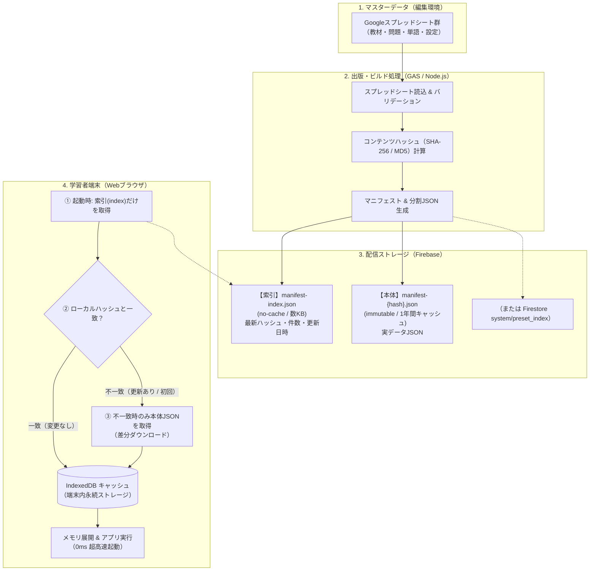

# Googleスプレッドシート × Firebase マニフェスト型データ管理アーキテクチャ設計書

本ドキュメントは、**「外部のGoogleスプレッドシートを正本（マスターデータ）とし、Firebaseを経由してWebアプリへ高速・超低コスト（無料枠内）で安全に配信する」** ためのデータ管理アーキテクチャを体系的に解説した設計書です。

別のWebアプリ（漢字クイズ・英単語学習など）へ同様のデータ管理機構を導入・移植する際のガイドラインとして活用してください。

---

## 1. アーキテクチャの全体像

本システムは、**「編集（スプシ）」「仲介・配信（Firebase）」「実行（端末IndexedDB）」** を完全に分離した多層キャッシュ構造を採用しています。



---

## 2. なぜこの設計にするのか？（解決する課題とメリット）

### ① Google スプレッドシート / GAS を直接クライアントから読まない理由
| 方式 | 課題・リスク |
| :--- | :--- |
| **クライアントから直接 GAS Web API を呼ぶ** | ・GASは同時実行数制限（30並列程度）があり、数十人が一斉アクセスすると即座に503エラーやタイムアウトが発生する。<br>・レスポンスに1〜3秒以上かかり、起動が非常に重い。<br>・Googleアカウントのクォータ上限に達すると全停止する。 |
| **スプレッドシートの公開CSV/JSONを直接fetch** | ・シートの構成変更や編集途中のデータが即時反映されてしまい、バグ・構文エラーでアプリがクラッシュする。<br>・Google側のレート制限やCORS問題が発生しやすい。 |

### ② Firestore にそのまま1行1ドキュメントで入れない理由
- 問題や単語が3,000問〜10,000件ある場合、初回や全問検索時に**3,000〜10,000回のドキュメント読み取り**が発生します。
- Firestoreの無料枠（Sparkプラン）は**1日50,000回読み取り**です。5〜10人の生徒がアクセスするだけで1日の無料枠を使い果たし、課金または停止に至ります。

### ③ 「ハッシュ付きマニフェスト ＋ IndexedDB」の絶大なメリット
1. **コストほぼゼロ（Spark無料プランで数万人規模まで運用可能）**:
   - 起動時の通信は「数KBのインデックスファイル取得」の1回のみ。
   - データが更新されていない場合、実データの通信量は**0バイト**、Firestoreの読み取りも**0回**。
2. **0ミリ秒の爆速起動 & オフライン耐性**:
   - 2回目以降の起動時は、端末内の IndexedDB からデータを直接メモリに展開するため、ネットワーク遅延なしで一瞬で起動可能。
   - 一時的な通信切断時でも学習を継続できる。
3. **安全な「出版（パブリッシュ）」モデル**:
   - 教員・作成者はスプレッドシートを好きな時に編集・下書きできる。
   - 「出版（ビルド）」を実行してFirebaseに新マニフェストが書き込まれるまでは、学習者に不完全なデータが届かない。
4. **完全なキャッシュ不整合防止（Cache-Busting）**:
   - データ内容が変わるとハッシュ値（例: `manifest-vocab.a1b2c3d4.json`）が変わるため、ブラウザやCDNのキャッシュ事故（古いデータが残り続ける問題）が原理的に起きない。

---

## 3. Firebase 内のデータ構造（マニフェストの設計）

本アーキテクチャでは、データを **「索引（インデックス）」** と **「実データ（本体）」** の2階層に分離します。

### (1) インデックスマニフェスト (`manifest-index.json` または Firestore ドキュメント)
最新のバージョン情報と、各データ種別のハッシュ値のみを持つ軽量なファイルです。

```json
{
  "schemaVersion": 1,
  "version": "2026-10-11T16:00:00Z",
  "exportedAt": "2026-10-11T16:00:00Z",
  "modes": {
    "kanji": {
      "hash": "e3b0c44298fc1c14",
      "count": 1200,
      "path": "data/manifest-kanji.e3b0c44298fc1c14.json"
    },
    "english": {
      "hash": "8f434346648f6b96",
      "count": 2500,
      "path": "data/manifest-english.8f434346648f6b96.json"
    }
  }
}
```
- **配置先**: Cloud Storage、Firebase Hosting、または Firestoreの `system/preset_index`
- **キャッシュ制御**: `Cache-Control: no-cache, max-age=0`（クライアントは毎回最新のハッシュを確認）

---

### (2) 実データ本体 (`manifest-{mode}.{hash}.json`)
各モードの全データ（またはブック・シート一覧と各レコード）。

```json
{
  "mode": "kanji",
  "hash": "e3b0c44298fc1c14",
  "generatedAt": "2026-10-11T16:00:00Z",
  "catalog": {
    "小学校1年": ["漢数字", "自然・体"],
    "小学校2年": ["生活", "方角"]
  },
  "rows": [
    {
      "id": "kanji_1_001",
      "kanji": "一",
      "reading": "イチ、ひと",
      "meaning": "ひとつ",
      "level": "小学校1年",
      "unit": "漢数字"
    }
  ]
}
```
- **配置先**: Cloud Storage または Firebase Hosting の静的ディレクトリ
- **キャッシュ制御**: `Cache-Control: public, max-age=31536000, immutable`（ハッシュが変わるまでブラウザとCDNに完全キャッシュ）

---

## 4. データ管理パイプラインの実装手順

### Step 1: スプレッドシートからの抽出・バリデーション（GAS側）

Google Apps Script（コンテナバインドまたはスタンドアロン）でスプレッドシートの行を抽出し、JSON用配列に成形します。

```javascript
/**
 * スプレッドシートの全シートを走査してレコード配列を生成する例
 */
function extractSheetData(spreadsheet) {
  const sheets = spreadsheet.getSheets();
  const allRows = [];
  const catalog = {};

  sheets.forEach(sheet => {
    const sheetName = sheet.getName();
    // 設定シートや除外シートはスキップ
    if (sheetName.startsWith('_') || sheetName === '出版ログ') return;

    const values = sheet.getDataRange().getValues();
    if (values.length < 2) return; // ヘッダーのみまたは空

    const headers = values[0];
    const sheetRows = [];

    for (let r = 1; r < values.length; r++) {
      const row = values[r];
      // 必須列が空の場合はスキップ
      if (!row[0]) continue;

      const record = {};
      headers.forEach((header, colIdx) => {
        if (header) {
          record[header] = row[colIdx];
        }
      });
      sheetRows.push(record);
    }

    catalog[sheetName] = sheetRows.length;
    allRows.push(...sheetRows);
  });

  return { catalog, rows: allRows };
}
```

---

### Step 2: コンテンツハッシュ（Digest）の算出

データ内容から一意なハッシュ文字列を生成します。空白や並び順の差による不要な更新を防ぐため、JSON文字列化してハッシュを計算します。

```javascript
/**
 * オブジェクトから短縮ハッシュ (12〜16桁) を計算する
 */
function computeContentHash(data) {
  const jsonStr = JSON.stringify(data);
  const rawHash = Utilities.computeDigest(
    Utilities.DigestAlgorithm.SHA_256,
    jsonStr,
    Utilities.Charset.UTF_8
  );
  
  // 16進数文字列に変換
  let hashHex = '';
  for (let i = 0; i < rawHash.length; i++) {
    const byte = rawHash[i];
    const hex = (byte < 0 ? byte + 256 : byte).toString(16);
    hashHex += (hex.length === 1 ? '0' : '') + hex;
  }
  return hashHex.substring(0, 16); // 先頭16文字で十分なユニーク性を確保
}
```

---

### Step 3: Firebase への保存・出版（ビルド）

出版方法には要件や環境に応じて2つのパターンがあります。

#### 【パターン A】GASからFirebase REST API（Storage / Firestore / RTDB）へ直接投入
GASの `UrlFetchApp` を使用して、FirebaseのREST APIまたはサービスアカウント認証でCloud Storage / RTDB / Firestoreに直接書き込みます。

- **利点**: スプレッドシート内のメニュー「出版する」ボタンを押すだけで即座にFirebaseへ反映される。
- **実装要点**:
  1. GASのプロパティにサービスアカウントキー（またはRTDBのシークレット）を保持。
  2. 実データJSONを Storage または RTDB に書き込む。
  3. 最後に `manifest-index`（Firestore `system/preset_index` または Storageの `index.json`）を上書き更新。

#### 【パターン B】GitHub Actions / Node.js スクリプトによる定時自動ビルド（Sparkプラン完全準拠）
スプレッドシートの書き出しAPI（またはGASのWebアプリ）をNode.jsスクリプトが定期取得し、ハッシュ付きJSONを生成してFirebase Hosting / Storageへデプロイ。

- **利点**: Cloud Functions不要、完全無料、Gitで変更履歴が管理可能。

---

### Step 4: クライアント側のフェッチ＆IndexedDBキャッシュ戦略

クライアント（ブラウザ）側では、**「毎回通信するが、実データは更新時しか取らない」** という制御を行います。

```javascript
// クライアント側（例: presetCache.js）の基本骨格

const DB_NAME = 'MyAppDataCache';
const STORE_NAME = 'manifests';

/**
 * 1. IndexedDB を初期化
 */
function openCacheDb() {
  return new Promise((resolve, reject) => {
    const req = indexedDB.open(DB_NAME, 1);
    req.onupgradeneeded = () => {
      req.result.createObjectStore(STORE_NAME, { keyPath: 'mode' });
    };
    req.onsuccess = () => resolve(req.result);
    req.onerror = () => reject(req.error);
  });
}

/**
 * 2. マニフェストの読み込みと自動同期
 */
async function loadManifest(mode) {
  const db = await openCacheDb();

  // ① ローカルキャッシュを取得
  const local = await new Promise((resolve) => {
    const tx = db.transaction(STORE_NAME, 'readonly');
    const req = tx.objectStore(STORE_NAME).get(mode);
    req.onsuccess = () => resolve(req.result || null);
    req.onerror = () => resolve(null);
  });

  // ② サーバーの軽量インデックスを取得 (no-cache)
  const indexRes = await fetch('/data/manifest-index.json', { cache: 'no-store' });
  if (!indexRes.ok) {
    // ネットワークエラー時はローカルキャッシュをそのまま返却（オフライン対応）
    if (local?.data) return local.data;
    throw new Error('インデックスを取得できませんでした');
  }

  const index = await indexRes.json();
  const remoteMeta = index.modes[mode];
  if (!remoteMeta) {
    return local?.data || null;
  }

  // ③ ハッシュ比較: 一致していればダウンロードせずローカルを返す
  if (local && local.hash === remoteMeta.hash && local.data) {
    console.log(`[Cache Hit] ${mode}: ローカルキャッシュ(hash: ${local.hash})を使用します`);
    return local.data;
  }

  // ④ ハッシュ不一致または初回: 新しい実データJSONをダウンロード
  console.log(`[Cache Miss / Update] ${mode}: 最新データを取得します (${remoteMeta.path})`);
  const dataRes = await fetch(remoteMeta.path);
  if (!dataRes.ok) throw new Error(`${mode} データのダウンロードに失敗しました`);

  const freshData = await dataRes.json();

  // ⑤ IndexedDB に最新ハッシュとともに保存
  await new Promise((resolve, reject) => {
    const tx = db.transaction(STORE_NAME, 'readwrite');
    tx.objectStore(STORE_NAME).put({
      mode: mode,
      hash: remoteMeta.hash,
      updatedAt: Date.now(),
      data: freshData
    });
    tx.oncomplete = () => resolve();
    tx.onerror = () => reject(tx.error);
  });

  return freshData;
}
```

---

## 5. 別のアプリ（漢字・英語アプリ等）へ移植する際の設計指針

### ① データの分割単位（チャンク設計）
データ量に応じてマニフェストの分割粒度を決定します。

- **総レコード数が〜数千件の場合**:
  - `manifest-kanji.{hash}.json` のように**モード単位で1ファイル**にまとめるのが最もシンプルで高速。
- **総レコード数が数万件以上、または画像・音声ファイルが大量にある場合**:
  - 本プロジェクト（`firebase-digital-drill`）の文法・単語のように、**「目録（catalog）マニフェスト」** と **「シート/級ごとの分割JSON」** に分け、ユーザーが開いた単元・シートだけを遅延ダウンロード（Lazy load）する構造にします。

### ② 古いキャッシュの自動削除（ガベージコレクション）
端末のストレージ（IndexedDB）容量を圧迫しないよう、新バージョン保存時に過去の古いハッシュデータをクリーンアップします。
```javascript
// 新しいハッシュ以外を削除する例
async function cleanOldCaches(currentModes) {
  // currentModes = { kanji: 'newHash1', english: 'newHash2' }
  // IndexedDB をスキャンし、キーが一致しない古いレコードを delete する
}
```

### ③ スプレッドシート運用上のベストプラクティス
1. **シート命名規則をルール化する**:
   - シート名をそのまま教材カテゴリ名や単元名（例: `小1_漢数字`, `英検3級_名詞`）として利用できるように命名規則を決めておく。
2. **バリデーションとスキップ行の明示**:
   - 作成途中の行や一時的に非公開にしたい行のために、先頭に「公開フラグ」列や「×（除外）」マークを置く仕様にしておくと、編集途中のデータ混入を防げます。
3. **出版ログシートの設置**:
   - GASで出版処理を走らせた際、スプレッドシート内に「出版ログ」シートを自動生成し、実行時刻・合格行数・エラー行理由を追記しておくと、誤入力の発見が極めて容易になります。

---

## 6. まとめチェックリスト

- [ ] **正本（スプシ）**: 教員・管理者が自由に編集できるマスター。
- [ ] **中間処理（GAS / Script）**: バリデーション ＋ ハッシュ計算 ＋ JSON生成。
- [ ] **配信（Firebase）**:
  - `manifest-index.json`（軽量・即時更新・no-cache）
  - `manifest-{mode}.{hash}.json`（イミュータブル・長期キャッシュ）
- [ ] **端末（Webアプリ）**:
  - 初回・更新時のみ本体をダウンロード。
  - 通常起動時は IndexedDB より 0ms でロード。
  - Spark無料プランでも月間数万〜数十万PVに余裕で耐えうる構成を実現。
