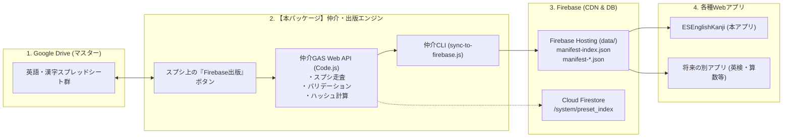

# スプレッドシート × Firebase 教材出版・データ仲介アプリ (Mediator)

本パッケージは、**「Googleスプレッドシート（正本）から教材データを検証・抽出し、ハッシュ付きマニフェストJSONとしてFirebaseへ出版する」** ための独立した仲介エンジンです。

学習者向けWebアプリ（`ESEnglishKanji` など）本体から「教材管理・出版機能」を完全に分離し、別アプリにもそのまま使い回せる共通基盤として設計されています。

---

## 1. 全体アーキテクチャ



---

## 2. 仲介GASプロジェクトのセットアップ手順

本パッケージの `gas/` 配下のコードを、新しい Google Apps Script プロジェクトとしてデプロイします。

### ステップ 1: 新しい GAS プロジェクトを作成
1. ブラウザで [script.google.com](https://script.google.com) を開きます。
2. **「新しいプロジェクト」** をクリックします。
3. プロジェクト名を **`Spreadsheet-Firebase-Mediator`** に変更します。

### ステップ 2: コードの配置
1. 左側のファイル一覧で `コード.gs` を開き、[`gas/Code.js`](./gas/Code.js) の内容を貼り付けて保存します。
2. 左メニュー「プロジェクトの設定（歯車アイコン）」→「「appsscript.json」マニフェスト ファイルをエディタで表示する」にチェックを入れます。
3. エディタに戻り、`appsscript.json` を開いて [`gas/appsscript.json`](./gas/appsscript.json) の内容で上書き保存します。

### ステップ 3: スクリプト プロパティの設定
「プロジェクトの設定」画面の下部にある **「スクリプト プロパティ」** に、以下を追加します：

| プロパティ名 | 値の説明 | 例 |
| :--- | :--- | :--- |
| `MATERIALS_FOLDER_ID` | 英語スプレッドシートが入っているGoogle DriveフォルダID | `1Dhd9b...` |
| `KANJI_MATERIALS_FOLDER_ID` | 漢字スプレッドシートが入っているGoogle DriveフォルダID | `1Z65C7...` |
| `FIREBASE_PROJECT_ID` | デプロイ先FirebaseプロジェクトID | `jikkenfirebasekankyo` |
| `NOTIFY_EMAILS` | 学習サマリー送信用保護者メールアドレス（カンマ区切り） | `parent@example.com` |

### ステップ 4: Web アプリとしてデプロイ
1. 画面右上の **「デプロイ」** → **「新しいデプロイ」** をクリックします。
2. 種類の選択: **「ウェブアプリ」** を選択。
3. 設定:
   - **次のユーザーとして実行**: `自分`
   - **アクセスできるユーザー**: `全員`
4. **「デプロイ」** をクリックし、発行された **ウェブアプリのURL** をコピーします。

---

## 3. 使い方

### 使い方 A: スプレッドシート上から出版・データ確認（手動）
教材マスター用スプレッドシートに本スクリプトを連携すると、上部メニューバーに **「🚀 Firebase出版 & データ仲介」** が表示されます：
1. **「1. 📚 教材マニフェストを検証・ビルド」**: 全シートの検証と出版ログ書き込み。
2. **「2. 📥 取り組み記録シートを確認・更新」**: アプリから蓄積された学習履歴（日時、ユーザー、問題数、正答率、獲得Pt）を一覧表示。
3. **「3. ✉️ 本日の学習サマリーをメール送信」**: 今日の学習実績を集計して保護者へHTMLレポート配信。

### 使い方 B: 仲介 CLI からワンコマンド同期
発行されたウェブアプリURLを使って、手元のPCから最新教材マニフェストを取得してFirebase Hostingに公開できます：

```powershell
# 【上流】教材マニフェストを取得して Firebase Hosting へ一発デプロイ
node cli/sync-to-firebase.js --mediator-url "https://script.google.com/macros/s/xxxx/exec"

# デプロイせずローカルの data/ 生成のみ
node cli/sync-to-firebase.js --mediator-url "https://script.google.com/macros/s/xxxx/exec" --skip-deploy

# 【下流】本日の学習サマリー配信をトリガー
node cli/sync-sessions.js --mediator-url "https://script.google.com/macros/s/xxxx/exec" --action daily_report
```

---

## 4. 他のアプリへの横展開について

新しいWebアプリ（例: 英検・算数アプリ等）を開発する際は、本仲介アプリのURLから `action: "manifest_index"` や `action: "export_all"` を呼ぶだけで、**同じスプレッドシート管理基盤をゼロコストで共有** できます。
また、`action: "log_learning_session"` を呼ぶことで、あらゆるアプリの学習ログを Google スプレッドシートへ自動集約できます。
